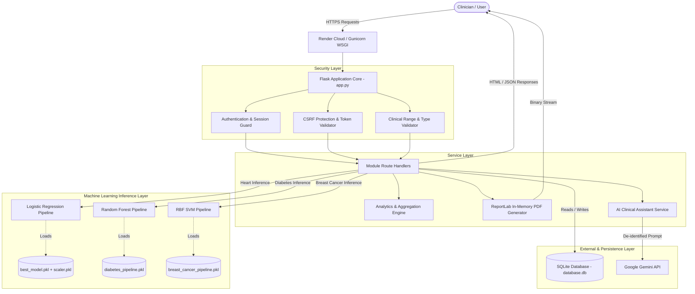

# Multi-Disease Clinical AI System

A full-stack, machine-learning-powered clinical decision support platform designed to assist healthcare professionals in evaluating patient risk for three major conditions: cardiovascular disease, diabetes mellitus, and breast cancer.

The platform combines validated predictive machine learning pipelines, relational patient record management, interactive clinical analytics, automated PDF report generation, and an AI clinical assistant powered by Google Gemini. The application is deployed on Render and is designed exclusively for educational, research, and clinical decision support purposes.

GitHub Repository: https://github.com/RAZA1409/Heart-Disease-Clinical-AI-System

---

## Table of ContentsI have reviewed and approved Stage 2 implementation with the following modifications.

Proceed with the approved repository organization.

### Approved changes

1. Move all 18 test modules into `tests/`.
2. Move the five review `.txt` files into `reports/archive/`.
3. Move the five offline training and experiment scripts into `scripts/`.
4. Archive `auth.py` into `docs/archive/` instead of deleting it.
5. Preserve the existing root application architecture.

### Required modifications to the original proposal

1. Keep `Heart_Disease_Cleaned.csv` at the project root for now. Do not move it.
2. Move `diabetes.csv` and `breast_cancer.csv` into `data/` only after updating and verifying every reference.
3. Keep `results.csv` at the root until all references and dependencies are verified.
4. Do not move or delete `heart_disease.db` until its status and purpose are independently confirmed. If confirmed to be an obsolete empty file, archive it.
5. Keep all model artifacts in their current `models/` locations. Do not rename or reorganize them.
6. Do not move databases, patient records, production backups, `.env`, virtual environments, templates or static assets.

### Implementation requirements

- Use `git mv` for tracked file movements.
- Update all affected imports, paths and test references.
- Preserve the exact Gunicorn entry point: `gunicorn app:app --bind 0.0.0.0:$PORT`.
- Preserve all existing Flask routes and functionality.
- Keep all 162 tests passing.
- Update README.md to reflect the actual final folder structure.
- Update `.gitignore` only where necessary.
- Do not modify production database contents or schemas.

### Final safety restrictions

- Do not commit, push, merge or deploy.
- Do not use `git reset --hard`, `git clean`, or broad deletion commands.
- Do not stage all files.
- Do not delete uncertain or unreferenced files without explaining why.
- Preserve all untracked user files and existing review history.
- Stop if a critical test fails; do not hide or bypass failures.

After implementation, provide:
1. Final folder structure.
2. Complete list of moved and archived files.
3. List of modified files.
4. Test results.
5. Git status.
6. Any unresolved issues.

Leave all changes available for my final review.v

- [Project Overview](#project-overview)
- [Key Features](#key-features)
- [System Architecture](#system-architecture)
- [Technology Stack](#technology-stack)
- [Machine Learning Implementation](#machine-learning-implementation)
  - [Heart Disease Prediction (Cardiovascular Module)](#heart-disease-prediction-cardiovascular-module)
  - [Experimental Genetic Algorithm Optimization](#experimental-genetic-algorithm-optimization)
  - [Diabetes Mellitus Prediction (Metabolic Module)](#diabetes-mellitus-prediction-metabolic-module)
  - [Breast Cancer Prediction (Oncology Module)](#breast-cancer-prediction-oncology-module)
- [Model Evaluation and Performance](#model-evaluation-and-performance)
- [Project Directory Structure](#project-directory-structure)
- [Application Workflow](#application-workflow)
- [AI Clinical Assistant](#ai-clinical-assistant)
- [Database Architecture](#database-architecture)
- [Installation and Local Setup](#installation-and-local-setup)
- [Environment Variables and Configuration](#environment-variables-and-configuration)
- [Testing Documentation](#testing-documentation)
- [Deployment on Render](#deployment-on-render)
- [Security Considerations](#security-considerations)
- [API and Routes Documentation](#api-and-routes-documentation)
- [Screenshots and User Interface](#screenshots-and-user-interface)
- [Limitations and Future Improvements](#limitations-and-future-improvements)
- [Medical Disclaimer](#medical-disclaimer)
- [Author and License](#author-and-license)

---

## Project Overview

Modern clinical decision-making often requires synthesizing complex demographic, metabolic, and diagnostic test data under tight time constraints. The Multi-Disease Clinical AI System addresses this challenge by providing an integrated, secure web workspace where healthcare staff can input clinical parameters, execute machine learning inferences across three distinct clinical modules, review quantitative risk tiers, generate de-identified documentation, and query an AI assistant regarding model outputs.

### Clinical Modules

1. **Cardiovascular Module (Heart Disease):** Assesses the presence of coronary artery disease using 13 clinical vitals and diagnostic indicators (resting blood pressure, serum cholesterol, electrocardiographic results, fluoroscopy vessel staining, and thallium stress scintigraphy).
2. **Metabolic Module (Diabetes Mellitus):** Predicts diabetes risk using 8 demographic and biological parameters from oral glucose tolerance testing, insulin assays, body mass index, and genetic pedigree calculations.
3. **Oncology Module (Breast Cancer):** Classifies fine needle aspiration (FNA) cytology specimens as benign or malignant across 30 nuclear morphometric characteristics (radius, texture, concavity, compactness, perimeter, and area).

### Educational and Research Scope

This platform is developed to demonstrate the end-to-end integration of supervised machine learning pipelines, evolutionary optimization research, secure web architectures, and conversational large language models in healthcare informatics. It is not an FDA-cleared diagnostic device and must not replace professional clinical judgment.

---

## Key Features

### Multi-Disease Clinical Inference
- Dedicated assessment forms tailored to clinical standards for cardiovascular, metabolic, and oncology domains.
- Real-time client- and server-side range validation protecting against physiologically implausible data entries.
- Automated feature scaling and missing-value imputation executing through scikit-learn pipelines.

### Risk Intelligence Engine
- Continuous probability scoring (0.0% to 100.0%) for every prediction.
- Standardized statistical risk categorization via `risk_config.py`:
  - **LOW Risk:** Probability < 30.0%
  - **MODERATE Risk:** Probability 30.0% to 69.9%
  - **HIGH Risk:** Probability >= 70.0%
- Algorithmic confidence scoring reflecting the distance of the prediction from the 50% decision boundary.
- Rule-based primary risk driver identification highlighting the most influential physiological deviations.
- Clinical alerts generated for acute parameter elevations (e.g., fasting blood sugar > 120 mg/dL, diastolic BP >= 90 mmHg, marked nuclear atypia).

### Clinical Analytics and Dashboards
- Multi-disease executive dashboard displaying patient volume, module utilization, and global risk distributions.
- Dedicated disease-specific analytics pages (`/analytics/heart`, `/analytics/diabetes`, `/analytics/breast_cancer`) featuring Chart.js visualizations.
- Interactive JSON API endpoints supporting aggregate metric retrieval (`?format=json`).

### Patient Record Management
- Persistent storage of complete diagnostic assessments in SQLite.
- Collision-resistant unique patient identifiers incorporating high-resolution timestamps and 8-hexadecimal-digit cryptographic entropy (`PID`, `DPID`, `BCP`).
- Module-specific historical review tables with sorting and search capabilities.
- Detailed patient reports featuring clinical feature summaries, alert banners, and recommended next steps.
- Secure, single-record deletion protected by session authentication.

### Automated PDF Report Generation
- Server-side, on-the-fly PDF generation using ReportLab.
- Streamed directly to the client browser via in-memory `BytesIO` buffers without persisting temporary files to disk.
- Standardized document formatting including patient reference, test date, clinical parameter grid, model inference, and medical disclaimers.

### Conversational AI Clinical Assistant
- Embedded on patient detail pages across all three disease modules.
- De-identifies patient records prior to prompt construction (patient names are strictly omitted).
- Backed by Google Gemini via the `google-genai` SDK with cascading model fallback across three model variants for maximum uptime.
- Strictly bounded by system instructions prohibiting the generation of official medical diagnoses or prescription instructions.

### Enterprise Security Architecture
- Session-based authentication backed by Werkzeug PBKDF2-HMAC-SHA256 password hashing.
- Mandatory production `SECRET_KEY` validation preventing insecure application boots.
- Per-session custom CSRF tokens required on all mutating HTTP requests (POST, PUT, DELETE, PATCH).
- HTTP-only, SameSite-restricted, and HTTPS-enforced session cookies.
- Global 30 MB request payload limit with strict 25 MB application limits on uploads.
- Complete defense against Cross-Site Scripting (XSS) through Jinja2 auto-escaping and DOM-safe text node rendering.

---

## System Architecture

The application implements a layered architecture separating presentation, session security, business logic, machine learning inference, persistence, and external AI services.



### Architectural Layer Responsibilities

- **Presentation Layer:** Jinja2 templates styled with custom responsive CSS (`static/style.css`) and modular JavaScript for asynchronous AI chat requests.
- **Security & Routing Layer (`app.py`):** Intercepts all requests, verifies active user sessions, validates CSRF tokens, parses JSON payloads, and handles session lifetime.
- **Inference Layer:** Dedicated joblib-serialized model artifacts loaded during application startup to minimize per-request latency.
- **Persistence Layer (`database.py`):** SQLite connection management with automatic database initialization, schema migration, and admin synchronization upon startup.
- **External Integration Layer:** Google Gemini API interaction utilizing streaming fallbacks to handle transient provider downtime.

---

## Technology Stack

The Multi-Disease Clinical AI System is built with Python and standard open-source libraries verified against `requirements.txt` and the repository codebase:

| Category | Technology | Version | Purpose |
|---|---|---|---|
| Runtime | Python | 3.11.9 | Core execution environment (specified in `runtime.txt`) |
| Web Framework | Flask | 3.1.3 | Core routing, session management, and HTTP processing |
| WSGI Server | Gunicorn | latest | Production multi-worker WSGI application server |
| Security & Hashing | Werkzeug | 3.1.6 | Cryptographic password hashing and secure HTTP helpers |
| Machine Learning | scikit-learn | 1.8.0 | Predictive model training, scaling, imputation, and evaluation |
| Optimization Research | DEAP | 1.4.3 | Distributed Evolutionary Algorithms in Python (GA study) |
| Data Processing | pandas | 3.0.1 | DataFrame structures, CSV data ingestion, and tabular transformations |
| Numerical Computing | numpy | 2.4.3 | Multi-dimensional array structures and vector operations |
| Scientific Computing | scipy | 1.17.1 | Statistical distributions and scientific calculations |
| Plotting & Visualization | matplotlib | 3.10.8 | Generating genetic algorithm convergence curves (`ga_convergence.png`) |
| Image Processing | Pillow | 12.1.1 | Image rendering support for generated plots and static media |
| PDF Document Generation | ReportLab | 4.4.10 | Programmatic clinical PDF report rendering in memory |
| Model Serialization | joblib | 1.5.3 | Serializing and deserializing scikit-learn estimators and pipelines |
| Database Engine | SQLite | stdlib (`sqlite3`) | Relational database engine for users and patient records |
| Conversational AI | google-genai | latest | Google Gemini API SDK for the AI clinical assistant |
| Environment Configuration | python-dotenv | latest | Parsing `.env` files for local development secrets |
| Templating Engine | Jinja2 | 3.1.6 | Dynamic HTML rendering with automatic context escaping |
| Testing Framework | unittest | stdlib | Comprehensive automated testing suite (18 test suites) |
| Cloud Hosting | Render | Cloud Platform | Web service deployment platform running Linux containers |

---

## Machine Learning Implementation

The platform incorporates three distinct supervised machine learning pipelines for production inference, alongside a dedicated evolutionary hyperparameter optimization research component.

### Heart Disease Prediction (Cardiovascular Module)

**Authoritative Pipeline Script:** `scripts/model_comparison.py`
**Production Classifier:** Logistic Regression
**Primary Artifacts:** `models/best_model.pkl`, `models/scaler.pkl`, `models/feature_columns.pkl`, `models/model_info.pkl`

#### Dataset & Clinical Features
The cardiovascular model is trained on `Heart_Disease_Cleaned.csv`, comprising 270 clinical observations and 13 independent diagnostic features:
- `Age`: Age in years (numeric).
- `Sex`: Biological sex (1 = Male, 0 = Female).
- `Chest pain type`: Angina classification (1 = Typical Angina, 2 = Atypical Angina, 3 = Non-Anginal Pain, 4 = Asymptomatic).
- `BP`: Resting systolic blood pressure in mmHg (numeric).
- `Cholesterol`: Serum cholesterol in mg/dL (numeric).
- `FBS over 120`: Fasting blood sugar > 120 mg/dL (1 = True, 0 = False).
- `EKG results`: Resting electrocardiography (0 = Normal, 1 = ST-T wave abnormality, 2 = Left ventricular hypertrophy).
- `Max HR`: Maximum heart rate achieved during exercise stress (numeric).
- `Exercise angina`: Exercise-induced angina (1 = Yes, 0 = No).
- `ST depression`: ST segment depression induced by exercise relative to rest (numeric).
- `Slope of ST`: Slope of peak exercise ST segment (1 = Upsloping, 2 = Flat, 3 = Downsloping).
- `Number of vessels fluro`: Major vessels colored by fluoroscopy (0 to 3).
- `Thallium`: Thallium stress scintigraphy defect (3 = Normal, 6 = Fixed defect, 7 = Reversible defect).
- `Target`: Binary presence (1) or absence (0) of coronary artery disease.

#### Training Methodology and Model Selection
1. **Train/Test Partition:** An 80/20 train/test split (216 training samples, 54 held-out test samples) is instantiated with `random_state=42`.
2. **Feature Normalization:** `sklearn.preprocessing.StandardScaler` is fitted exclusively on the 216 training samples and subsequently transforms the test partition to eliminate data leakage.
3. **Multi-Model Evaluation:** Three candidate classifiers are trained and evaluated under identical conditions:
   - `LogisticRegression(max_iter=1000)`
   - `SVC(probability=True)`
   - `RandomForestClassifier(n_estimators=100)`
4. **Deterministic Selection:** `model_comparison.py` programmatically selects the highest-performing model based on held-out test accuracy. Logistic Regression achieved the highest accuracy (**90.74%**) and was selected as the production classifier.

#### Production Inference Workflow
During runtime in `app.py`:
1. Form inputs from `/predict` are validated and mapped from clinical terms to numeric integers via `FEATURE_MAP`.
2. A single-row pandas DataFrame is constructed with exact column ordering matching `feature_columns.pkl`.
3. The data is transformed using `scaler.pkl`.
4. Probabilities are generated via `model.predict_proba()`.
5. The positive class probability is formatted as a percentage and assigned a risk tier via `risk_config.py`.

---

### Experimental Genetic Algorithm Optimization

**Research Script:** `scripts/train_model.py`
**Purpose:** Academic study of evolutionary algorithm-based hyperparameter tuning.
**Frameworks:** DEAP (Distributed Evolutionary Algorithms in Python) + scikit-learn.
**Artifacts Generated:** `models/ga_model.pkl`, `models/ga_scaler.pkl`, `models/ga_feature_columns.pkl`, `models/ga_convergence.png`, `results.csv`.

#### Methodology
- The experimental workflow utilizes a Genetic Algorithm to explore the continuous hyperparameter space of a Support Vector Classifier (RBF kernel), specifically tuning the regularization parameter $C \in [0.1, 100.0]$ and kernel coefficient $\gamma \in [0.0001, 1.0]$.
- **Chromosome Representation:** Individuals consist of two floating-point genes representing $C$ and $\gamma$.
- **Fitness Evaluation:** 5-fold cross-validated accuracy across the training partition.
- **Genetic Operators:** Two-point crossover (`cxUniform` or `cxBlend`), Gaussian mutation (`mutGaussian`), and tournament selection (`selTournament`).
- **Convergence Tracking:** Fitness statistics over generations are recorded and plotted to `models/ga_convergence.png`. Individual runs are logged to `results.csv` via `experiment_logger.py`.

> [!IMPORTANT]
> The Genetic Algorithm optimization in `train_model.py` is strictly an experimental research component. It **does not** generate or overwrite the production model artifacts (`best_model.pkl`). The production heart disease inference pipeline in `app.py` runs the Logistic Regression model selected by `model_comparison.py`.

---

### Diabetes Mellitus Prediction (Metabolic Module)

**Authoritative Pipeline Script:** `scripts/train_diabetes.py`
**Production Classifier:** Random Forest Classifier (Balanced)
**Primary Artifacts:** `models/diabetes_pipeline.pkl`, `models/diabetes_feature_columns.pkl`, `models/diabetes_model_info.pkl`

#### Dataset & Features
Trained on the Pima Indians Diabetes Dataset comprising 768 patient records and 8 clinical features:
- `Pregnancies`: Number of pregnancies.
- `Glucose`: 2-hour plasma glucose concentration in an oral glucose tolerance test (mg/dL).
- `BloodPressure`: Diastolic blood pressure (mmHg).
- `SkinThickness`: Triceps skin fold thickness (mm).
- `Insulin`: 2-hour serum insulin ($\mu$U/mL).
- `BMI`: Body mass index ($\text{weight in kg} / (\text{height in m})^2$).
- `DiabetesPedigreeFunction`: Genetic diabetes pedigree score.
- `Age`: Age in years.

#### Preprocessing & Model Architecture
1. **Handling Biologically Implausible Zeros:** Zero values in `Glucose`, `BloodPressure`, `SkinThickness`, `Insulin`, and `BMI` represent missing data rather than true zero measurements. A `ColumnTransformer` applies `SimpleImputer(strategy='median')` to these five columns, followed by `StandardScaler`.
2. **Classifier Configuration:** `RandomForestClassifier(n_estimators=100, max_depth=6, class_weight='balanced', random_state=42)` is encapsulated with the transformer inside an end-to-end `sklearn.pipeline.Pipeline`.
3. **Partitioning:** Evaluated on an 80/20 stratified split (154 held-out test samples).
4. **Primary Feature Drivers:** Glucose (31.1% importance), BMI (16.6% importance), and Age (12.3% importance).

---

### Breast Cancer Prediction (Oncology Module)

**Authoritative Pipeline Script:** `scripts/train_breast_cancer.py`
**Production Classifier:** Support Vector Machine (RBF Kernel, Balanced)
**Primary Artifacts:** `models/breast_cancer_pipeline.pkl`, `models/breast_cancer_feature_columns.pkl`, `models/breast_cancer_model_info.pkl`

#### Dataset & Features
Trained on the Wisconsin Diagnostic Breast Cancer (WDBC) dataset comprising 569 fine needle aspiration (FNA) cytology records. Each observation contains 30 continuous morphometric features describing cell nuclei:
- 10 core nuclear characteristics: radius, texture, perimeter, area, smoothness, compactness, concavity, concave points, symmetry, and fractal dimension.
- Each characteristic is represented by its Mean, Standard Error (SE), and "Worst" (mean of the three largest values) across the biopsy slide.
- Target: Binary classification (1 = Malignant, 0 = Benign).

#### Pipeline Architecture
1. **Pipeline Composition:** An integrated `Pipeline` combining `StandardScaler()` and `SVC(kernel='rbf', C=1.0, probability=True, class_weight='balanced', random_state=42)`.
2. **Validation:** 5-fold stratified cross-validation on the 80% training set followed by final evaluation on a 114-sample held-out stratified test set.
3. **Performance Focus:** High sensitivity and balanced accuracy to minimize false negatives in malignant cytology detection.

---

## Model Evaluation and Performance

All metrics in this table are computed strictly on held-out test partitions and extracted directly from the verified model metadata artifacts (`model_info.pkl`, `diabetes_model_info.pkl`, `breast_cancer_model_info.pkl`):

| Evaluation Metric | Heart Disease (Logistic Regression) | Diabetes (Random Forest Balanced) | Breast Cancer (RBF SVM Balanced) |
|---|---|---|---|
| Model Architecture | Logistic Regression (`max_iter=1000`) | Random Forest (`n_estimators=100, max_depth=6`) | Support Vector Machine (`kernel='rbf', C=1.0`) |
| Training Dataset | `Heart_Disease_Cleaned.csv` | Pima Indians Diabetes Dataset | Wisconsin Diagnostic Breast Cancer (WDBC) |
| Total Records | 270 samples | 768 samples | 569 samples |
| Test Partition Size | 54 samples (20%) | 154 samples (20%) | 114 samples (20%) |
| Test Accuracy | **90.74%** | **75.32%** | **98.25%** |
| Precision | 90.00% | 63.33% | 97.62% |
| Recall (Sensitivity) | 85.71% | 70.37% | 97.62% |
| Specificity | 93.94% | 78.00% | 98.61% |
| F1 Score | 87.80% | 66.67% | 97.62% |
| Balanced Accuracy | 89.83% | 74.19% | 98.12% |
| ROC-AUC | 94.66% | 81.96% | 99.54% |
| Test Log Loss | 0.3167 | Not applicable | Not applicable |

### Test Set Confusion Matrices

#### Heart Disease Module ($N = 54$)
- True Negatives (Absence correctly identified): **31**
- False Positives (Absence predicted as Present): **2**
- False Negatives (Present predicted as Absent): **3**
- True Positives (Present correctly identified): **18**

#### Diabetes Module ($N = 154$)
- True Negatives (Negative correctly identified): **78**
- False Positives (Negative predicted as Positive): **22**
- False Negatives (Positive predicted as Negative): **16**
- True Positives (Positive correctly identified): **38**

#### Breast Cancer Module ($N = 114$)
- True Negatives (Benign correctly identified): **71**
- False Positives (Benign predicted as Malignant): **1**
- False Negatives (Malignant predicted as Benign): **1**
- True Positives (Malignant correctly identified): **41**

### Heart Disease Candidate Model Comparison

During execution of `model_comparison.py`, three classifiers were evaluated on the held-out test split:
1. **Logistic Regression:** 90.74% Test Accuracy, 0.3167 Test Loss (Selected for Production)
2. **Support Vector Classifier (RBF):** 88.89% Test Accuracy, 0.3592 Test Loss
3. **Random Forest Classifier:** 83.33% Test Accuracy, 0.4072 Test Loss

---

## Project Directory Structure

```
Heart_Disease_Optimization_Project/
├── app.py                               # Core Flask web application and routing (2571 lines)
├── run.py                               # Local development server launcher with status logging
├── predict.py                           # Interactive CLI prediction tool for heart disease
├── main.py                              # Command-line helper displaying execution instructions
├── init_db.py                           # Standalone database initialization script
├── database.py                          # SQLite database schema, connections, and admin bootstrap
├── risk_config.py                       # Centralized risk classification thresholds and color schemes
├── requirements.txt                     # Pinned project dependencies for pip
├── runtime.txt                          # Python version specification for Render (python-3.11.9)
├── Procfile                             # Process file defining the web worker command
├── README.md                            # Primary technical documentation
├── .env.example                         # Template documenting required environment variables
├── .gitignore                           # Git ignore rules for environments, databases, and caches
├── Heart_Disease_Cleaned.csv            # Cleveland Heart Disease dataset (tracked)
├── results.csv                          # Historical experiment results log (tracked)
├── data/                                # Project dataset storage
│   ├── diabetes.csv                     # Pima Indians Diabetes dataset (ignored by Git)
│   └── breast_cancer.csv                # WDBC reference dataset (ignored by Git)
├── models/                              # Serialized model artifacts and metadata
│   ├── best_model.pkl                   # Production Logistic Regression classifier
│   ├── scaler.pkl                       # Production StandardScaler for heart disease
│   ├── feature_columns.pkl              # Ordered feature names for heart disease
│   ├── model_info.pkl                   # Production heart disease evaluation metrics
│   ├── optimization_comparison.pkl      # Comparative candidate model metrics
│   ├── diabetes_pipeline.pkl            # Production Diabetes sklearn Pipeline
│   ├── diabetes_feature_columns.pkl     # Ordered feature names for diabetes
│   ├── diabetes_model_info.pkl          # Production diabetes evaluation metrics
│   ├── breast_cancer_pipeline.pkl       # Production Breast Cancer sklearn Pipeline
│   ├── breast_cancer_feature_columns.pkl# Ordered feature names for breast cancer
│   ├── breast_cancer_model_info.pkl     # Production breast cancer evaluation metrics
│   ├── ga_model.pkl                     # Experimental GA-optimized SVC artifact
│   ├── ga_scaler.pkl                    # Experimental GA scaler artifact
│   ├── ga_feature_columns.pkl           # Experimental GA feature list
│   └── ga_convergence.png               # Plot of GA fitness across generations
├── scripts/                             # Offline model training & optimization pipelines
│   ├── model_comparison.py              # Production heart disease training, comparison, and export
│   ├── train_diabetes.py                # Production diabetes pipeline training and export
│   ├── train_breast_cancer.py           # Production breast cancer pipeline training and export
│   ├── train_model.py                   # Experimental GA-based hyperparameter tuning for SVC
│   └── experiment_logger.py             # CSV experiment logger for evolutionary algorithm runs
├── tests/                               # Automated test suite (all 18 test suites)
│   ├── __init__.py                      # Test package marker
│   ├── test_admin_startup_sync.py
│   ├── test_chatbot_multi_disease.py
│   ├── test_patient_name_persistence_and_display.py
│   ├── test_phase1_verification.py
│   ├── test_phase2_verification.py
│   ├── test_phase3_verification.py
│   ├── test_phase4_verification.py
│   ├── test_phase5_verification.py
│   ├── test_phase6b_verification.py
│   ├── test_phase8a_backend_aggregation.py
│   ├── test_phase8b_dashboard_ui.py
│   ├── test_phase8c_analytics_ui.py
│   ├── test_phase8d_form_ui.py
│   ├── test_phase8e_diabetes_form.py
│   ├── test_phase8f_breast_cancer_form.py
│   ├── test_phase8g_patient_detail.py
│   ├── test_phase8h_auth_and_result.py
│   └── test_xss_remediation.py
├── templates/                           # Jinja2 HTML presentation templates
│   ├── login.html                       # Clinician authentication interface
│   ├── forgot_password.html             # Password recovery interface
│   ├── change_password.html             # Authenticated password reset interface
│   ├── dashboard.html                   # Multi-disease executive dashboard
│   ├── predict.html                     # Heart disease diagnostic entry form
│   ├── result.html                      # Heart disease prediction outcome view
│   ├── history.html                     # Heart disease historical records table
│   ├── patient_detail.html              # Heart disease clinical interpretation view
│   ├── heart_analytics.html             # Heart disease aggregate visual analytics
│   ├── diabetes_predict.html            # Diabetes diagnostic entry form
│   ├── diabetes_result.html             # Diabetes prediction outcome view
│   ├── diabetes_history.html            # Diabetes historical records table
│   ├── diabetes_patient_detail.html     # Diabetes clinical interpretation view
│   ├── diabetes_analytics.html          # Diabetes aggregate visual analytics
│   ├── breast_cancer_predict.html       # Breast cancer diagnostic entry form
│   ├── breast_cancer_result.html        # Breast cancer prediction outcome view
│   ├── breast_cancer_history.html       # Breast cancer historical records table
│   ├── breast_cancer_patient_detail.html# Breast cancer clinical interpretation view
│   ├── breast_cancer_analytics.html     # Breast cancer aggregate visual analytics
│   └── ai_chatbot.html                  # Reusable clinical assistant chat widget
├── static/
│   └── style.css                        # Complete responsive styling stylesheet
├── reports/                             # Technical audit & pre-deployment reports
│   ├── PR1_FAST_PRODUCTION_AUDIT.md     # Pre-deployment audit report
│   └── archive/                         # Preserved phase diff & review logs
│       ├── diabetes_form_diff_review.txt
│       ├── phase5_review.txt
│       ├── phase6b_diff_review.txt
│       ├── phase8f_final_diff.txt
│       └── phase8f_html_diff.txt
└── docs/                                # Technical documentation
    ├── HEART_MODEL_TRAINING.md          # Architectural notes on model comparison
    └── archive/                         # Deprecated/historical files
        ├── auth.py                      # Archived legacy authentication script
        └── heart_disease.db.bak         # Archived 0-byte legacy database
```

---

## Application Workflow

The clinician workflow progresses through authentication, diagnostic data collection, model execution, analytical review, and optional AI consultation:

```mermaid
flowchart TD
    Start([Clinician Opens Portal]) --> AuthCheck{Session Active?}
    AuthCheck -->|No| Login[Enter Username & Password at /login]
    Login --> VerifyAuth{Credentials Valid?}
    VerifyAuth -->|No| LoginError[Display Authentication Error] --> Login
    VerifyAuth -->|Yes| Dashboard[/dashboard - Executive Overview]
    AuthCheck -->|Yes| Dashboard

    Dashboard --> SelectModule{Select Disease Module}

    SelectModule -->|Heart Disease| HForm[Fill 13 Cardiovascular Vitals at /predict_page]
    SelectModule -->|Diabetes| DForm[Fill 8 Metabolic Values at /diabetes/predict]
    SelectModule -->|Breast Cancer| BForm[Fill 30 Cytological Measurements at /breast_cancer/predict]

    HForm --> HPost[POST /predict - Validate & Standardize]
    DForm --> DPost[POST /diabetes/predict - Validate & Impute]
    BForm --> BPost[POST /breast_cancer/predict - Validate & Scale]

    HPost --> Inference[Pipeline Execution & Probability Calculation]
    DPost --> Inference
    BPost --> Inference

    Inference --> RiskTier[Map Probability to Risk Tier: LOW, MODERATE, HIGH]
    RiskTier --> GenID[Generate Unique Patient Identifier]
    GenID --> SaveDB[(Persist Assessment to SQLite Database)]
    SaveDB --> ShowResult[Display Immediate Prediction Outcome View]

    ShowResult --> ReviewChoice{Clinician Review Actions}
    ReviewChoice -->|View History| HistView[Browse Historical Records Table]
    ReviewChoice -->|Examine Detail| DetailView[Open Comprehensive Patient Detail View]

    DetailView --> Interpretation[Review Risk Drivers, Interpretation & Alerts]
    Interpretation --> ActionFork{Further Clinical Actions}

    ActionFork -->|Export Documentation| PDFGen[GET /download_report - Stream In-Memory PDF]
    ActionFork -->|Consult Assistant| AIChat[POST /ai_assistant - Query De-Identified Record]
    ActionFork -->|Manage Record| DeleteRec[POST /delete - Purge Assessment Record]

    Dashboard --> AnalyticsView[View Aggregate Analytics & Distribution Charts]
```

---

## AI Clinical Assistant

The AI Clinical Assistant provides authorized clinicians with an on-demand, conversational interface to explore patient-specific risk factors directly on the detail pages of all three disease modules.

### Backend Implementation (`POST /ai_assistant`)
1. **Authentication Check:** The endpoint verifies that an active authenticated session exists. Unauthenticated calls return HTTP 401.
2. **CSRF Validation:** All requests must supply a valid CSRF token in the JSON payload (`csrf_token`) or via the `X-CSRFToken` header.
3. **Record Resolution & De-Identification:**
   - The patient ID prefix determines which database table is queried: `PID` queries `patients`, `DPID` queries `diabetes_patients`, and `BCP` queries `breast_cancer_patients`.
   - The patient's clinical vitals, calculated probability, risk tier, rule-based alerts, and primary risk driver are compiled into a formatted clinical context string.
   - **Crucially, the patient's name is completely excluded.** The prompt references only `[De-identified] (<patient_id>)` to prevent Personal Identifiable Information (PII) leakage to the LLM.
4. **Clinical Safety System Instruction:**
   - The model is instructed to maintain an objective, professional decision-support tone.
   - Explicit guardrails forbid providing definitive diagnoses, prescribing drug regimens or dosages, or speculating on parameters not present in the record.
   - Outputs must be framed as statistical probability estimates intended to augment clinical judgment.
5. **Cascading Model Fallback:**
   To guarantee continuous availability during upstream quota pressure or model maintenance, the system iterates sequentially across three Google Gemini models:
   1. `gemini-3.6-flash` (Primary)
   2. `gemini-3.5-flash` (Secondary)
   3. `gemini-3.1-flash-lite` (Tertiary)
   If a model throws an API exception or rate-limit error, the application logs the error and immediately falls back to the next model in the cascade.
6. **Graceful Degradation:**
   If all three models are exhausted, the endpoint returns a user-friendly HTTP 503 response without leaking technical stack traces. If `GEMINI_API_KEY` is not configured, the endpoint returns a clear 503 indicating assistant unavailability.
7. **Alternative Provider Status:**
   `app.py` imports `openai`, but the OpenAI client block is commented out in favor of the Google Gemini integration.

---

## Database Architecture

The system utilizes SQLite via Python's standard library `sqlite3` module. The active database path is managed through `database.py` and defaults to `database.db` unless overridden by the `DATABASE_PATH` environment variable.

### Database Initialization & Multiprocessing Safety
`init_db()` is invoked at module level upon importing `database.py`. This ensures that whenever Gunicorn spawns worker processes in production, all tables, indices, and the default administrator account exist before incoming requests are accepted.

### Entity Schemas

#### 1. `users` Table
Stores authenticated clinician credentials.
```sql
CREATE TABLE IF NOT EXISTS users (
    id INTEGER PRIMARY KEY AUTOINCREMENT,
    username TEXT UNIQUE NOT NULL,
    password TEXT NOT NULL
);
```

#### 2. `patients` Table (Cardiovascular Assessments)
```sql
CREATE TABLE IF NOT EXISTS patients (
    id INTEGER PRIMARY KEY AUTOINCREMENT,
    patient_id TEXT UNIQUE NOT NULL,
    patient_name TEXT,
    age INTEGER,
    sex INTEGER,
    cp INTEGER,
    trestbps INTEGER,
    chol INTEGER,
    fbs INTEGER,
    restecg INTEGER,
    thalach INTEGER,
    exang INTEGER,
    oldpeak REAL,
    slope INTEGER,
    ca INTEGER,
    thal INTEGER,
    result TEXT,
    probability REAL,
    risk_level TEXT,
    timestamp DATETIME DEFAULT CURRENT_TIMESTAMP
);
```

#### 3. `diabetes_patients` Table (Metabolic Assessments)
```sql
CREATE TABLE IF NOT EXISTS diabetes_patients (
    id INTEGER PRIMARY KEY AUTOINCREMENT,
    patient_id TEXT UNIQUE NOT NULL,
    patient_name TEXT,
    age INTEGER,
    pregnancies INTEGER,
    glucose REAL,
    blood_pressure REAL,
    skin_thickness REAL,
    insulin REAL,
    bmi REAL,
    dpf REAL,
    result TEXT,
    probability REAL,
    risk_level TEXT,
    timestamp DATETIME DEFAULT CURRENT_TIMESTAMP
);
```

#### 4. `breast_cancer_patients` Table (Cytological Assessments)
Contains `id`, `patient_id`, `patient_name`, `age`, the 30 WDBC nuclear morphometric columns (`mean_radius`, `mean_texture`, ..., `worst_fractal_dimension`), `result`, `probability`, `risk_level`, and `timestamp`.

### Ephemeral Storage on Render Free Tier

> [!WARNING]
> Render Free web services operate on ephemeral container filesystems. Any modifications to `database.db` are stored in the temporary container layer and are completely reset whenever the container is restarted, redeployed, or spun down due to inactivity. For persistent production deployments, the application should be linked to an external PostgreSQL database or a persistent disk volume.

---

## Installation and Local Setup

These instructions are tested for **Windows PowerShell** environments using Python 3.11.9.

### 1. Clone the Repository
```powershell
git clone https://github.com/RAZA1409/Heart-Disease-Clinical-AI-System.git
cd Heart-Disease-Clinical-AI-System
```

### 2. Configure Virtual Environment
```powershell
python -m venv .venv
.\.venv\Scripts\Activate.ps1
```

### 3. Install Required Dependencies
```powershell
python -m pip install --upgrade pip
pip install -r requirements.txt
```

### 4. Configure Environment Variables
Copy the provided `.env.example` file to create your local `.env`:
```powershell
Copy-Item .env.example .env
```
Open `.env` in an editor and set your credentials:
```ini
SECRET_KEY="local-development-secret-key-replace-in-production"
ADMIN_DEFAULT_PASSWORD="YourSecurePassword123"
ADMIN_RECOVERY_CODE="YourSecureRecoveryCode123"
DATABASE_PATH="database.db"
GEMINI_API_KEY=""  # Optional: Paste Google Gemini API key to enable AI assistant
PORT=5000
FLASK_DEBUG="true"
```

### 5. Initialize the Database (Optional Standalone Check)
The application automatically creates the database on startup, but you can initialize it manually:
```powershell
python init_db.py
```

### 6. Verify Model Artifacts (Optional Retraining)
Pre-trained model artifacts are included in `models/`. If you wish to retrain them from scratch:
```powershell
python scripts/model_comparison.py
python scripts/train_diabetes.py
python scripts/train_breast_cancer.py
```

### 7. Run the Application
You can launch the application using the local development runner:
```powershell
python run.py
```
Alternatively, you can run Flask directly:
```powershell
python app.py
```

### 8. Access the Application
Open your web browser and navigate to:
```
http://localhost:5000/login
```
Sign in with username `admin` and the password configured in `ADMIN_DEFAULT_PASSWORD`.

### 9. Command-Line Prediction Tool
To run heart disease inference from the command line without the web server:
```powershell
python predict.py
```

---

## Environment Variables and Configuration

The application parses environment variables using `python-dotenv`. In production environments, variables must be configured directly within the hosting platform dashboard.

| Variable Name | Required | Default / Fallback | Purpose & Operational Impact |
|---|---|---|---|
| `SECRET_KEY` | Mandatory in Production | `dev-insecure-secret-key-change-in-production` (Dev only) | Cryptographic key for signing session cookies and CSRF tokens. Application throws a `RuntimeError` on startup if missing when `RENDER` or `FLASK_ENV=production` is detected. |
| `ADMIN_DEFAULT_PASSWORD` | Mandatory | `admin123` | Password used to initialize or synchronize the default `admin` user account upon startup. |
| `ADMIN_RECOVERY_CODE` | Mandatory | `RECOVER-ADMIN-2026` | Emergency passphrase required to reset the administrator password via `/forgot_password`. |
| `DATABASE_PATH` | Optional | `database.db` | Filesystem path to the SQLite database file. |
| `SESSION_COOKIE_SECURE` | Optional | `false` locally, forced `true` in production | Enforces the `Secure` flag on session cookies, restricting transmission to HTTPS connections. |
| `GEMINI_API_KEY` | Optional | `None` | API key for Google Gemini. If omitted, the AI assistant endpoint returns HTTP 503 without crashing the server. |
| `OPENAI_API_KEY` | Optional | `None` | Reserved for potential alternative LLM backends (currently unused by active routes). |
| `PORT` | Optional | `5000` | Network port for the HTTP server. Render sets this dynamically at runtime. |
| `FLASK_DEBUG` | Optional | `false` | Enables Flask interactive debugger and auto-reloader. Must remain disabled in production. |
| `RENDER` | Auto-set by Render | `None` | Trigger used by `app.py` to activate production security policies (mandatory secrets, secure cookies). |

---

## Testing Documentation

The project includes an extensive test suite built on Python's native `unittest` framework, covering end-to-end routing, database operations, security enforcement, ML pipelines, and UI integrity.

### Running the Test Suite
Execute test discovery from the project root:
```powershell
python -m unittest discover -s tests -p "test_*.py" -v
```

### Test Suite Summary
- **Total Test Files:** 18 modules
- **Verified Passing Tests:** **162 out of 162 tests passing**
- **External Dependency Isolation:** All tests run independently of external network connectivity. Chatbot tests (`test_chatbot_multi_disease.py`) utilize `unittest.mock.patch` on `app.gemini_client` to verify cascading fallbacks and error handling without issuing live API calls.

### Test Module Coverage Directory

| Test Module | Test Focus & Verification Scope |
|---|---|
| `test_phase1_verification.py` | Model loading, artifact integrity, and basic app configuration |
| `test_phase2_verification.py` | Authentication flows, session handling, login, logout, and password resets |
| `test_phase3_verification.py` | Heart disease prediction endpoint, input transformation, and validation errors |
| `test_phase4_verification.py` | Patient history persistence, database record insertion, and deletion |
| `test_phase5_verification.py` | ReportLab PDF generation, HTTP headers, and stream content verification |
| `test_phase6b_verification.py` | Global CSRF validation, session token checks, and unauthorized state mutation blocks |
| `test_phase8a_backend_aggregation.py` | Multi-disease backend aggregation queries and summary statistics |
| `test_phase8b_dashboard_ui.py` | Executive dashboard rendering, data binding, and JSON mode verification |
| `test_phase8c_analytics_ui.py` | Disease-specific analytics view rendering across all three modules |
| `test_phase8d_form_ui.py` | Cardiovascular prediction form fields, input restrictions, and labels |
| `test_phase8e_diabetes_form.py` | Diabetes assessment form submission, validation ranges, and results display |
| `test_phase8f_breast_cancer_form.py` | Breast cancer 30-feature cytology form submission, parsing, and results display |
| `test_phase8g_patient_detail.py` | Detailed patient report views, clinical interpretation, and risk indicators |
| `test_phase8h_auth_and_result.py` | Route-level authentication requirements and prediction result page rendering |
| `test_admin_startup_sync.py` | Startup admin user synchronization from environment credentials |
| `test_chatbot_multi_disease.py` | AI assistant context formatting, PII de-identification, model fallback, and 503 handling |
| `test_patient_name_persistence_and_display.py` | Collision-resistant ID generation and patient name title-casing |
| `test_xss_remediation.py` | Cross-site scripting (XSS) input sanitization and zero-innerHTML DOM safety |

### Syntax and Compilation Verification
To confirm Python bytecode compilation and Git whitespace hygiene:
```powershell
python -m py_compile app.py
git diff --check
```

---

## Deployment on Render

The application is deployed on Render as a Python Web Service.

### Verified Production Configuration
- **Hosting Service:** Render (Web Service)
- **Environment:** Python 3
- **Production Branch:** `main`
- **Auto-Deploy:** **OFF** (Manual deployment only to prevent untested releases)
- **Build Command:** `pip install -r requirements.txt`
- **Render Dashboard Start Command:** `gunicorn app:app --bind 0.0.0.0:$PORT`

### Distinction: Render Start Command vs. Procfile
The repository includes a `Procfile`:
```
web: python -c "from database import init_db; init_db()" && gunicorn --workers 2 app:app
```
**Operational Distinction:**
- When deploying to Render, the command entered into the **Start Command field of the Render Service Dashboard** (`gunicorn app:app --bind 0.0.0.0:$PORT`) takes precedence over the `Procfile`.
- Database initialization is guaranteed because `init_db()` is called on module import in `database.py`, which is imported when `app.py` is initialized by Gunicorn. The explicit invocation in `Procfile` provides redundant assurance in Heroku-compatible environments.

### Step-by-Step Render Deployment Guide
1. **Repository Setup:** Ensure your updates are merged into the `main` branch on GitHub.
2. **Create Web Service:** In the Render Dashboard, select **New +** -> **Web Service** and connect repository `RAZA1409/Heart-Disease-Clinical-AI-System`.
3. **Environment Settings:**
   - **Runtime:** `Python 3` (Render automatically detects `runtime.txt` specifying `python-3.11.9`).
   - **Branch:** `main`
   - **Build Command:** `pip install -r requirements.txt`
   - **Start Command:** `gunicorn app:app --bind 0.0.0.0:$PORT`
   - **Auto-Deploy:** Select **No** to enforce manual deployment verification.
4. **Environment Variables:** Navigate to the **Environment** tab and add:
   - `SECRET_KEY`: Generate a 64-character random string.
   - `ADMIN_DEFAULT_PASSWORD`: Set a strong administrative password.
   - `ADMIN_RECOVERY_CODE`: Set a secure recovery code.
   - `GEMINI_API_KEY`: Provide your Google Gemini API key.
   - `PYTHON_VERSION`: `3.11.9` (optional backup for runtime specification).
5. **Trigger Deployment:** Click **Manual Deploy** -> **Deploy latest commit**.
6. **Log Inspection:** Monitor the build and runtime logs to verify:
   - Successful pip wheel builds.
   - Gunicorn worker spawning without `RuntimeError`.
   - SQLite initialization confirmation.

---

## Security Considerations

The application implements defense-in-depth security principles suitable for clinical data handling:

- **Strict Production Secret Key Enforcement:** The application checks `os.getenv("RENDER")` or `FLASK_ENV == "production"` during startup. If `SECRET_KEY` is undefined or empty, a fatal `RuntimeError` halts execution, preventing deployment with insecure default keys.
- **CSRF Token Validation:** All state-modifying requests (POST, PUT, DELETE, PATCH) are verified against a cryptographically secure token stored in the user's session. Submissions failing CSRF checks receive HTTP 400.
- **Cryptographic Password Hashing:** Passwords are never stored in plaintext. Passwords are hashed using Werkzeug's implementation of PBKDF2 with HMAC-SHA256 and salted iterations.
- **Cookie Security Hardening:**
  - `SESSION_COOKIE_HTTPONLY = True`: Blocks JavaScript access to session cookies, mitigating session-hijacking via XSS.
  - `SESSION_COOKIE_SAMESITE = 'Lax'`: Mitigates Cross-Site Request Forgery across third-party contexts.
  - `SESSION_COOKIE_SECURE = True`: Automatically enforced in production environments, ensuring cookies are transmitted strictly over HTTPS.
- **Payload & File Upload Restrictions:** Flask's `MAX_CONTENT_LENGTH` is set to 30 MB globally, with application-level limits of 25 MB on file processing routines to prevent Denial of Service (DoS) memory exhaustion.
- **Clinical Input Sanitization & Range Checks:** Input features are validated against strict biological boundaries before being passed to ML models or SQL queries. Out-of-bounds numbers or non-numeric types trigger user-facing HTTP 400 error messages.
- **Zero-innerHTML DOM Architecture:** Front-end JavaScript renders dynamic content (such as chat messages and alerts) exclusively through safe DOM methods (`document.createElement`, `textContent`, `appendChild`), eliminating DOM-based XSS vulnerabilities.
- **PII De-Identification in AI Integrations:** The AI Clinical Assistant strips patient names and identifiers before transmitting clinical vitals to Google Gemini.

---

## API and Routes Documentation

All routes require active session authentication unless explicitly listed as public.

| HTTP Method | Route Path | Access Level | Description |
|---|---|---|---|
| `GET` | `/` | Public | Entry route; redirects authenticated sessions to `/dashboard` and unauthenticated sessions to `/login`. |
| `GET`, `POST` | `/login` | Public | Clinician authentication interface and credential verification. |
| `GET` | `/logout` | Authenticated | Clears user session and redirects to login. |
| `GET`, `POST` | `/forgot_password` | Public | Emergency password reset authenticated via `ADMIN_RECOVERY_CODE`. |
| `GET`, `POST` | `/change_password` | Authenticated | Password update form requiring current password verification. |
| `GET` | `/dashboard` | Authenticated | Platform overview across all three disease modules. Accepts `?format=json`. |
| `GET` | `/predict_page` | Authenticated | Renders the 13-feature cardiovascular assessment form. |
| `POST` | `/predict` | Authenticated | Executes heart disease inference, saves assessment, and renders result. |
| `GET` | `/history` | Authenticated | Historical table of cardiovascular patient assessments. |
| `GET` | `/patient/<patient_id>` | Authenticated | In-depth clinical interpretation and risk report for a heart disease patient. |
| `GET` | `/download_report/<patient_id>` | Authenticated | Generates and streams an in-memory PDF report for heart disease. |
| `POST` | `/delete/<patient_id>` | Authenticated | Permanently deletes a heart disease assessment record. |
| `GET` | `/analytics/heart` | Authenticated | Aggregate statistical visualizations for heart disease. Accepts `?format=json`. |
| `GET` | `/diabetes/predict` | Authenticated | Renders the 8-feature metabolic assessment form. |
| `GET` | `/diabetes_predict_page` | Authenticated | Legacy route alias redirecting to `/diabetes/predict`. |
| `POST` | `/diabetes/predict` | Authenticated | Executes diabetes inference, saves assessment, and renders result. |
| `GET` | `/diabetes/history` | Authenticated | Historical table of diabetes patient assessments. |
| `GET` | `/diabetes/patient/<patient_id>` | Authenticated | In-depth clinical interpretation and risk report for a diabetes patient. |
| `GET` | `/diabetes/download_report/<patient_id>`| Authenticated | Generates and streams an in-memory PDF report for diabetes. |
| `POST` | `/diabetes/delete/<patient_id>` | Authenticated | Permanently deletes a diabetes assessment record. |
| `GET` | `/analytics/diabetes` | Authenticated | Aggregate statistical visualizations for diabetes. Accepts `?format=json`. |
| `GET` | `/breast_cancer/predict` | Authenticated | Renders the 30-feature cytology assessment form. |
| `GET` | `/breast_cancer_predict_page` | Authenticated | Legacy route alias redirecting to `/breast_cancer/predict`. |
| `POST` | `/breast_cancer/predict` | Authenticated | Executes breast cancer inference, saves assessment, and renders result. |
| `GET` | `/breast_cancer/history` | Authenticated | Historical table of breast cancer patient assessments. |
| `GET` | `/breast_cancer/patient/<patient_id>` | Authenticated | In-depth clinical interpretation and risk report for a breast cancer patient. |
| `GET` | `/breast_cancer/download_report/<patient_id>` | Authenticated | Generates and streams an in-memory PDF report for breast cancer. |
| `POST` | `/breast_cancer/delete/<patient_id>` | Authenticated | Permanently deletes a breast cancer assessment record. |
| `GET` | `/analytics/breast_cancer` | Authenticated | Aggregate statistical visualizations for breast cancer. Accepts `?format=json`. |
| `POST` | `/ai_assistant` | Authenticated | JSON API endpoint querying Google Gemini with de-identified patient data. |

---

## Screenshots and User Interface

Screenshots of the user interface can be added to the repository under `static/screenshots/`.

### Interface Views

#### 1. Clinician Authentication Portal
File: `static/screenshots/login.png`
*Secure login interface with session management and error messaging.*

#### 2. Multi-Disease Executive Dashboard
File: `static/screenshots/dashboard.png`
*Central navigation portal summarizing aggregate case numbers and risk distributions across modules.*

#### 3. Cardiovascular Assessment Form
File: `static/screenshots/heart_predict.png`
*Structured entry form with clinical units for blood pressure, cholesterol, ECG, and stress test metrics.*

#### 4. Diagnostic Outcome & Risk Assessment
File: `static/screenshots/heart_result.png`
*Prediction outcome display featuring continuous probability percentages and color-coded risk tiers.*

#### 5. Patient Detail & Clinical Interpretation
File: `static/screenshots/patient_detail.png`
*Comprehensive diagnostic summary showing key risk drivers, automated alerts, and actionable recommendations.*

#### 6. Embedded AI Clinical Assistant
File: `static/screenshots/ai_assistant.png`
*Slide-out chat modal allowing clinicians to query de-identified patient data via Google Gemini.*

#### 7. Clinical Analytics & Visualization
File: `static/screenshots/heart_analytics.png`
*Interactive graphical charts displaying risk tier distributions and metric correlations.*

#### 8. Generated Clinical PDF Report
File: `static/screenshots/pdf_report.png`
*Formal, branded PDF document generated in memory for patient records or archival documentation.*

---

## Limitations and Future Improvements

### Current Platform Limitations
- **Benchmark Dataset Scope:** Models are trained on standard academic benchmark datasets (Cleveland Heart Disease: 270 records, Pima Indians Diabetes: 768 records, WDBC: 569 records). While statistically robust, they do not encompass the full clinical and demographic variability of larger hospital populations.
- **Ephemeral Storage on Free Tier:** Running SQLite on Render Free containers means patient records are not permanently preserved across application restarts or container rebuilds.
- **Single Administrative Role:** The current access model supports a single authenticated user role without fine-grained Role-Based Access Control (RBAC) separating nursing staff, attending physicians, and system administrators.
- **Stateless AI Chat Sessions:** The AI assistant evaluates individual prompt requests against current patient context but does not maintain multi-turn chat history across separate browser refreshes.
- **Absence of Audit Logging:** Clinical systems typically require tamper-evident logging of all data views and modifications for HIPAA/GDPR compliance.

### Planned Engineering Improvements
- **Managed Relational Database:** Transition SQLite to managed PostgreSQL on Render or AWS RDS with automated daily backups.
- **Granular RBAC:** Introduce role-based permissions distinguishing diagnostic entry, record deletion, and user account management.
- **Model Retraining Pipelines:** Integrate MLflow or automated GitHub Actions workflows to retrain, evaluate, and version-tag models upon dataset updates.
- **Explainable AI (XAI) Integration:** Incorporate SHAP (SHapley Additive exPlanations) or LIME to provide visual waterfall plots explaining feature contributions for individual predictions.
- **FHIR / HL7 Compatibility:** Build standardized export interfaces conforming to Fast Healthcare Interoperability Resources (FHIR) to allow integration with electronic health record (EHR) platforms.

---

## Medical Disclaimer

**IMPORTANT NOTICE: THIS SOFTWARE IS FOR RESEARCH, DEMONSTRATION, AND EDUCATIONAL PURPOSES ONLY.**

The Multi-Disease Clinical AI System is a computer software tool developed to demonstrate machine learning classification and software architecture principles in biomedical informatics.

- **Not a Diagnostic Medical Device:** This software is not certified, cleared, or approved as a medical device by the United States Food and Drug Administration (FDA), the European Medicines Agency (EMA), or any other public health authority.
- **Statistical Estimates Only:** All outputs, predictions, probabilities, risk tiers, and AI assistant interpretations generated by this software are statistical probability estimates produced by algorithmic models trained on historical research datasets. They do not constitute medical advice, clinical diagnoses, prognostic determinations, or therapeutic prescriptions.
- **No Substitute for Professional Judgment:** This application must never be used as a substitute for the clinical judgment, diagnosis, or treatment planning of a licensed physician or certified healthcare provider.
- **No Clinical Reliance:** Healthcare professionals, researchers, and individuals must not make clinical interventions, alter medication regimens, or initiate or withhold treatment based upon the information generated by this system.
- **Limitation of Liability:** The authors, contributors, and copyright holders disclaim all liability for any clinical decisions, damages, or adverse outcomes resulting from the use or misuse of this software.

---

## Author and License

### Author Information
- **Author:** Mohammad Raza
- **GitHub Profile:** https://github.com/RAZA1409
- **Project Repository:** https://github.com/RAZA1409/Heart-Disease-Clinical-AI-System

### License
No formal open-source license file is currently present in this repository. All rights are reserved by the author. Inquiries regarding academic citation, usage, or distribution permissions should be directed to the repository author via GitHub.
